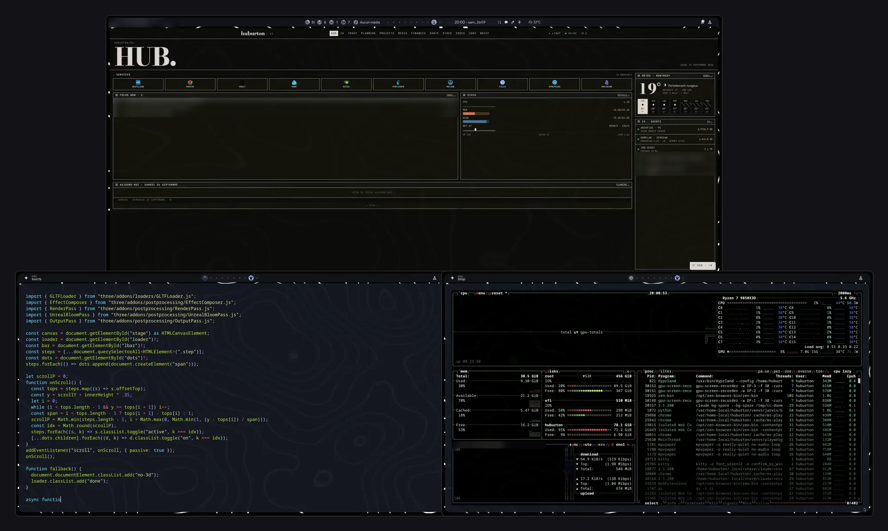
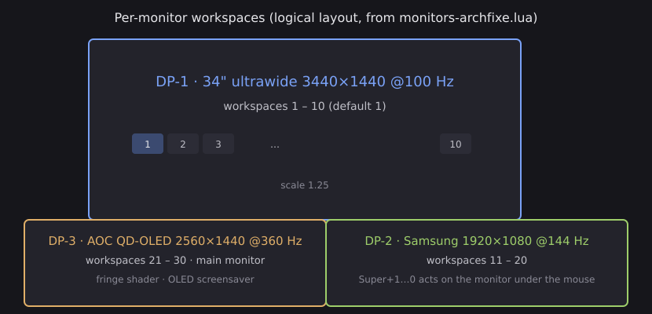
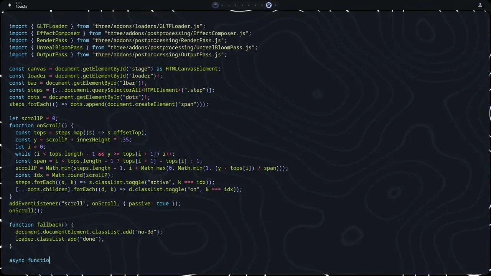
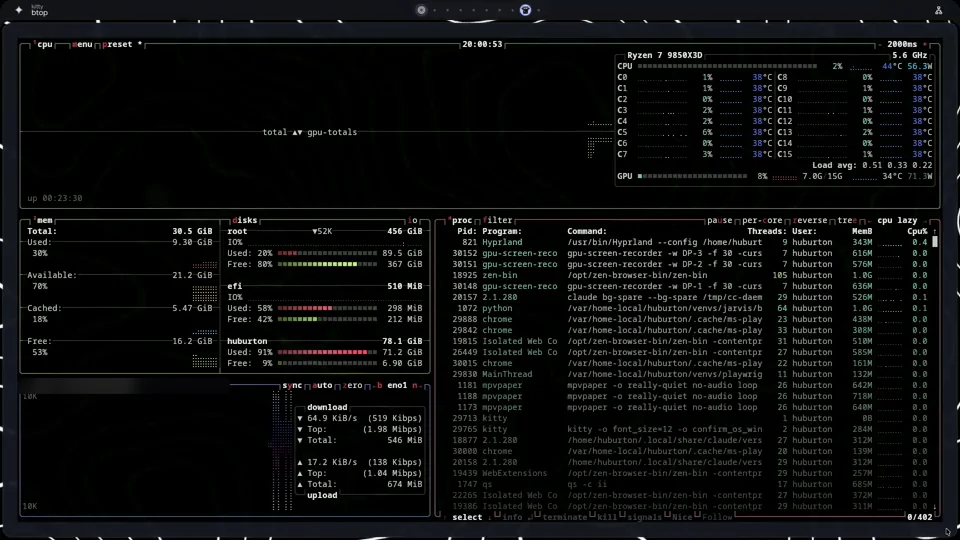

# dotfiles: my Arch Linux + Hyprland desktop

The configuration of my daily desktop: Arch Linux, Hyprland configured in **Lua**, a
[Quickshell](https://quickshell.org) shell based on end-4's
[illogical-impulse](https://github.com/end-4/dots-hyprland) (ii), three monitors and an NVIDIA RTX 5080,
in a Secure Boot dual boot with Windows.

This is a snapshot of a working machine, not an installer. Paths, monitor names and keyboard codes
match my hardware; adapt them before reusing anything.

## What it looks like



*Frames recorded on 2026-09-26, placed as the monitors are arranged on the desk: 34" ultrawide on top
(my home dashboard), 27" QD-OLED bottom left (kitty), 27" 144 Hz bottom right (btop). Two private areas
of the dashboard are blurred.*



| Main monitor (QD-OLED, 360 Hz) | Side monitor |
|---|---|
|  |  |

## What is in it

| Part | What it does |
|---|---|
| `hypr/hyprland.lua`, `config.lua`, `binds.lua` | Whole Hyprland config in Lua: settings, window rules, 160+ binds. Every bind carries a `description = "Section\|Text"` that the shell reads live to build the cheatsheet. |
| `hypr/workspaces.lua` | Per-monitor workspaces (1–10, 11–20, 21–30) and a small Lua API used by the binds and the shell. |
| `hypr/tests/workspaces-test.py` | Regression test with real input: 155 checks across the three monitors. |
| `hypr/monitors-<hostname>.lua` | Layout per machine, written by `bin/hypr-monitors-save` while `wdisplays` is open. |
| `hypr/shaders/qdoled-fringe.frag` + `bin/oled-fringe` | Colour-fringe correction for the QD-OLED panel. |
| `bin/wallpaper-video` | Video wallpaper with GPU/CPU guards and a static fallback. |
| `bin/oled-screensaver`, `hypr/hypridle.conf` | Two-minute idle screensaver, nothing else. |
| `bin/session-daemons`, `bin/hyprland-conf-session` | Session start and supervision, relock after a shell crash. |
| `bin/ai-mode`, `bin/pc-status` | Hand the GPU to a local LLM server and back. |
| `system/sbin/maj-auto` + units | Automatic updates, with the kernel group installed at shutdown and checked. |
| `quickshell-ii/` | Only the files I added to ii. See [`quickshell-ii/README.md`](quickshell-ii/README.md). |
| `docs/secure-boot.md` | The shim → GRUB → unified kernel image chain. |

## What I adapted, in detail

### 1. Hyprland in Lua, on hyprland-git

**Problem.** I run Hyprland from git to get the Lua configuration. That build no longer reads `.conf`
files or `source=` lines at all, so the whole ii configuration (written as `.conf`) was silently ignored.

**What did not work.** Several things fail without any error:
- unknown Lua option keys are ignored: `window.move{ silent = true }` does nothing (the option is
  `follow = false`), and the bind option `repeat_key` does nothing (it is `repeating`);
  `hyprctl eval` catches wrong types and missing keys, not unknown keys;
- `hyprctl dispatch X` now runs `return hl.dispatch(X)`, so the old text syntax is dead; every call
  has to pass Lua, for example `hyprctl dispatch 'hl.dsp.focus({ workspace = "3" })'`;
- numeric arguments to `hl.dsp.window.fullscreen(n)` are ignored: it always goes fullscreen.
  Maximize is `{ mode = "maximized" }`;
- in `hyprctl monitors all -j`, the `disabled` field reads `true` for active monitors on this build.
  Trusting it once wrote `disabled = true` for all three screens, and the next reload switched them all off.

**Solution.** `hyprland.lua` loads `config.lua`, `workspaces.lua`, `binds.lua`, the shell overrides, then
`monitors-<hostname>.lua` (with `monitors.lua` as fallback), because `~/.config` is shared over NFS with my
laptop. All 21 dispatch call sites in the shell's QML were ported to Lua dispatchers. The monitor
saver only trusts `hyprctl monitors -j` (active outputs), and a generated monitor file is compared with
the live state before any reload.

### 2. Workspaces that belong to a monitor

**Problem.** With three monitors, Hyprland's default is one global list of workspaces: Super+3 can pull
workspace 3 onto whatever monitor has focus, and the layout drifts during the day.

**Solution.** Each monitor owns ten ids, like macOS Spaces: the ultrawide 1–10, the side monitor 11–20,
the OLED 21–30 (diagram above). `workspaces.lua` declares the rules and a global `hypr_ws` API:
`go(n)` opens workspace *n* of the monitor **under the mouse**, `move(n)` sends the active window to
workspace *n* of its own monitor, `rel(±1)` steps inside the range without wrapping, and `focus_id(id)`
shows an id on its owner monitor and moves it back if it was misplaced. It all runs inside Hyprland's
Lua state, so a bind costs no `hyprctl` round trip. The shell's bar and overview use the same API.

**Shell side.** On this build, Quickshell's Hyprland workspace objects are wrong: the JSON has no
workspace id, so every monitor reports the focused workspace as its own. The shell reads
`hyprctl … -j` itself instead (`services/HyprlandData.qml`), with helpers per monitor. Its refresh is
debounced (120 ms): an animated window title (a terminal spinner) fires about four events a second and
was spawning dozens of `hyprctl` processes per second.

### 3. Testing binds with real input

**Problem.** `wtype` sends keys to the focused window but does not trigger compositor binds, so it cannot
test them.

**Solution.** `hypr/tests/workspaces-test.py` drives `ydotool` (kernel-level input) and checks the result
with `hyprctl -j`: number row and keypad, Shift and Alt variants, relative moves, mouse position on each
monitor, clicks on the bar. 155 checks, about three minutes, hands off the mouse; it restores the
workspaces at the end. It passed 155/155 when the workspace model was finished.

### 4. French AZERTY and keycodes

Hyprland matches the **unshifted** keysym. On AZERTY the number row produces `&é"'(-è_çà` without Shift,
so `Super + 1` never fires, and `/` or `.` (Shift level) never match as `Super + Slash` or `Period`.
Workspace binds therefore use keycodes (`code:10` to `code:19`), which do not depend on the layout.
Another set of binds makes Ctrl+Alt behave like AltGr, as on Windows: `Ctrl + Alt + code:N` sends the
same key with `MOD5`. An XKB-level approach did not work: Zen typed nothing and kitty ignored the level
while Ctrl or Alt were held.

### 5. QD-OLED colour fringes

**Problem.** The main monitor (an AOC at 360 Hz) has a QD-OLED panel. Its subpixels are triangles: green on top, red
bottom left, blue bottom right. Light text on a dark background gets a green edge above and a magenta
edge below. Fonts were already rendered in greyscale, so it comes from the panel geometry, not from
font rendering.

**Solution.** `bin/oled-fringe` generates a Hyprland screen shader (`qdoled-fringe.frag`, checked with
`glslangValidator`) that resamples each colour channel at its subpixel's real position, in linear
light. It only acts when the texture size equals that monitor's resolution, so the other two monitors
pass through unchanged. The orientation comes from `dFdy` on the texture coordinates. The preset
`complet` (green −0.25 px, red and blue +0.25 px vertically and ±0.20 px horizontally) won a
side-by-side comparison against a sharper preset; `oled-fringe ab` alternates two presets every three
seconds for that.

A user service owns the shader setting. It re-applies it after every config reload (the lock screen
reloads the config on each lock and unlock), removes it while a real fullscreen window is on that
monitor (games), and never overrides another shader such as ii's anti-flashbang filter.
Screenshots do not include the screen shader, so the effect can only be judged on the monitor itself.

### 6. Video wallpaper with guards

**Problem.** One evening the wallpaper (`mpvpaper`) used 500 % CPU. An NVIDIA userspace update had been
installed while the session was running, so the userspace driver no longer matched the loaded kernel
module and every new `mpvpaper` decoded and rendered on the CPU. On top of that, ii started one
instance per monitor, about 1.3 GB of VRAM each, and the screensaver started three more.

**Solution.** `bin/wallpaper-video` runs as a user service and starts **one** `mpvpaper` for all outputs
(about 1.5 GB of VRAM in total, paused when hidden). Before starting it checks that `nvidia-smi` works
and that at least 2 GB of VRAM is free. It kills the player above 40 % of a core over 30 s, restarts it
above 2.5 GB of memory, backs off on crash loops, and in every failure case falls back to a static
image and sends one notification. ii's wallpaper switcher calls it instead of starting its own players.
The real cause, live driver updates, is handled by the update script (section 8).

### 7. Session supervision and relock

**Problem.** If the shell (`qs`) crashed, the bar, notifications and lock screen were gone until the next
login. If it crashed while the screen was locked, Hyprland stayed on its "lock screen crashed" page.

**Solution.** `bin/session-daemons` holds a lock file and runs keep-alive loops for the shell, the idle
daemon, the scratchpad daemon and clipboard history: a process that stops is restarted after one second,
or after ten if it lived less than thirty seconds. The lock screen writes a marker file in
`$XDG_RUNTIME_DIR` while it is locked; a shell started while that marker exists locks again immediately.
Tested with `kill -9` on the shell: the bars came back on all three monitors. A bar health check
(through `hyprctl layers`) replaced an older blind restart after five seconds.

### 8. Automatic updates, with the kernel checked before the next boot

**Problem.** Updating everything live breaks things: NVIDIA userspace no longer matches the loaded
module, a new Qt no longer matches the running shell, a new `hyprctl` no longer matches the running
Hyprland. On the other side, the unified kernel image has to be rebuilt and signed or the next boot
fails under Secure Boot.

**Solution.** `system/sbin/maj-auto`, run by systemd:
- `fond` (hourly timer, real pass at most every 20 h): skips while a game or `pacman` is running, pauses
  when an Arch news item mentions a manual intervention, installs everything except a "restart group"
  (kernel, NVIDIA, Hyprland, Qt, Quickshell), only downloads that group, updates Flatpaks, and notifies;
- `extinction` (when the machine shuts down): installs the restart group, then checks that the DKMS
  NVIDIA module exists for the new kernel (rebuilds it if not), that the UKI really contains that kernel
  version (its `.uname` section, rebuilt with `mkinitcpio -P` if not) and that it is signed. The result is
  shown as a notification at the next login;
- AUR packages are never updated automatically, only reported.

### 9. Secure Boot dual boot

A game anticheat on the Windows side requires Secure Boot, so Linux boots with it on through
shim → GRUB → a signed unified kernel image. The details (embedded GRUB modules, SBAT, why a UKI
fixed a black screen, re-signing hooks) are in [`docs/secure-boot.md`](docs/secure-boot.md).

### 10. Sharing the GPU with a local LLM

**Problem.** The RTX 5080 also serves a local language model for my other projects. The model needs
most of the VRAM, and the video wallpaper takes 1.5 GB.

**Solution.** `bin/ai-mode on` pauses the video wallpaper (static image, VRAM freed); `ai-mode off`
resumes it, and the wallpaper service waits for enough free VRAM. `bin/pc-status` exposes the state over
HTTP to my home server, protected by the local model server's key, and switches AI mode on by itself
when the OLED screensaver has been running for ten minutes. In AI mode the screensaver covers the OLED
monitor only, with a small software-decoded video.

## Smaller things

- Launcher: ii's launcher has no exclude list, so `bin/hide-apps` writes hidden copies of the `.desktop`
  files I don't want to see; a path unit re-runs it whenever packages change.
- Monitors are set with `wdisplays`, which applies a layout live but saves nothing; `bin/wdisplays-persist`
  saves the live layout every two seconds while it is open.
- Comments are partly in French, the language I work in.

## Layout

```
hypr/            Hyprland (Lua), shader, tests
bin/             session and desktop scripts (~/.local/bin)
systemd/user/    user units for the services above
system/          root-owned parts (updates), installed by hand
quickshell-ii/   my additions to end-4's illogical-impulse shell
docs/            Secure Boot notes, images
```

## License

GPL-3.0, like illogical-impulse, since `quickshell-ii/` builds on it. See [LICENSE](LICENSE).
